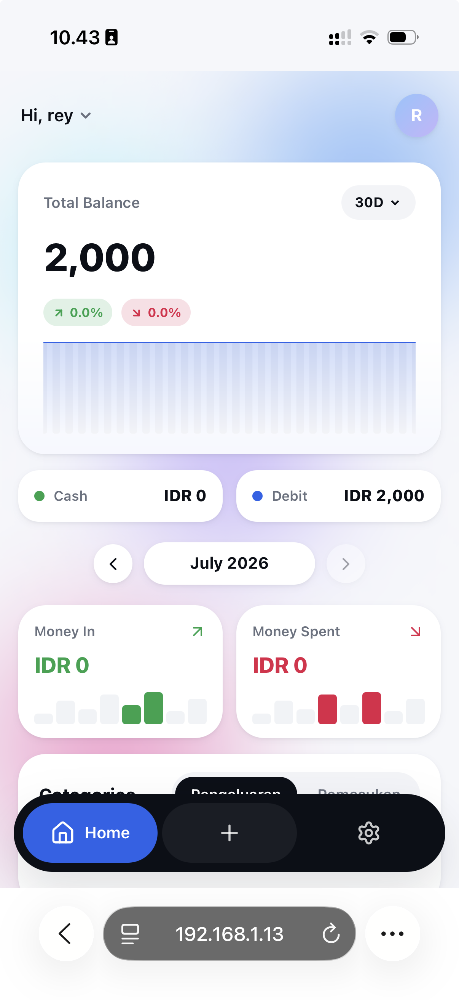
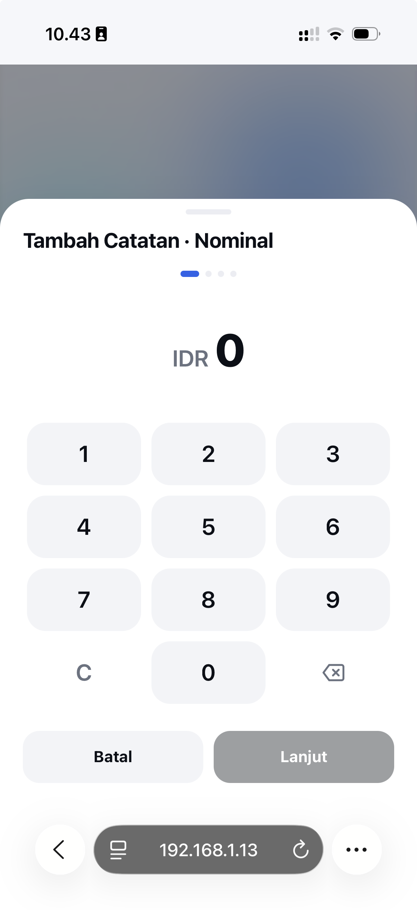
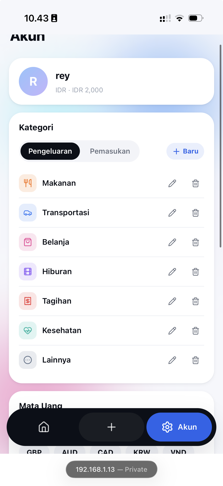

<div align="center">

# 💸 Spendy

### Track your spending — offline-first, installable, and alive.

A mobile-first Progressive Web App for tracking personal income and expenses, built entirely client-side with a native-app feel: fluid GSAP animations, an animated aurora background, and a slot-machine-style balance reveal.

[](./LICENSE)
[](https://kit.svelte.dev/)
[](https://bun.sh/)
[](#-installing-as-an-app)
[](#-roadmap)

</div>

---

## ✨ Overview

**Spendy** is a personal finance / spending-tracker app you can install like a native app on Android, iOS, Windows, macOS, or Linux — yet it's just a website under the hood. There's no backend, no account, no cloud sync: every transaction lives in your browser's IndexedDB (via Dexie.js), and you stay in control of your own data through manual JSON export/import.

The goal isn't just "another CRUD expense tracker" — it's an exploration of how _alive_ a PWA can feel: morphing dock navigation, a slot-machine digit reveal for balances, a slowly drifting aurora-gradient background, and a fully animated onboarding experience, all powered by GSAP.

## 🖼️ Screenshots & Demo

<div align="center">
### 🎬 Demo

<video src="docs/screenshots/video.mp4" controls width="320"></video>

_(Video not showing? [Watch it directly](docs/screenshots/video.mp4) — inline video preview only renders on github.com, not on every markdown viewer.)_

### 📱 Screens

<table>
  <tr>
    <td align="center"><br/><sub><b>Dashboard</b></sub></td>
    <td align="center"><br/><sub><b>Add Transaction</b></sub></td>
    <td align="center"><br/><sub><b>Settings</b></sub></td>
  </tr>
</table>
</div>

## 🚀 Features

- **Guided first-run onboarding** — brand intro, a short feature carousel, and a setup step for your starting **Debit/Bank** and **Cash** balances.
- **Animated dashboard** — total balance, income vs. spending trend, and per-category breakdown at a glance.
- **Category pie/donut charts** — see exactly where your money comes from and where it goes, per category, per month.
- **4-step "Add Transaction" wizard** — amount → category → income/expense → date & time (auto-filled with "now" if left blank), all with smooth animated transitions.
- **Custom categories & multi-currency** — define your own income/expense categories (icon + color) and pick your preferred currency; every amount across the app reformats automatically.
- **Slot-machine balance reveal** — key numbers roll through digits before settling on the real value, like a mechanical counter.
- **Animated aurora background** — a soft, drifting pastel-gradient glow behind the header of every screen.
- **Morphing bottom dock** — a 3-item floating nav (Dashboard · Add Transaction · Account/Settings) with a pill indicator that glides between icons.
- **100% offline-first** — built on IndexedDB/Dexie.js; the app works fully without an internet connection.
- **Manual backup, no cloud** — export your entire dataset to a single `.json` file, and import it back anytime (e.g. when moving to a new device). No servers, no accounts, no telemetry.
- **Installable PWA** — add it to your home screen / start menu on any OS, with full offline app-shell caching.

## 🧱 Tech Stack

| Layer                     | Choice                                                                 |
| ------------------------- | ---------------------------------------------------------------------- |
| Runtime & package manager | [Bun](https://bun.sh/)                                                 |
| Framework                 | [SvelteKit](https://kit.svelte.dev/) (Svelte 5 + runes), TypeScript    |
| Animation                 | [GSAP](https://gsap.com/) (Flip, Draggable where needed)               |
| Local database            | [Dexie.js](https://dexie.org/) over IndexedDB (single source of truth) |
| Backup                    | Client-side JSON export/import (`Blob` + `FileReader`, no backend)     |
| PWA / offline             | Web App Manifest + Service Worker (app-shell cache-first)              |
| Charts                    | Lightweight chart library, animated via GSAP timelines                 |

No server, no database-as-a-service, no auth provider — the entire app ships as static assets.

## 📂 Project Structure

```
spendy/
├─ src/
│  ├─ routes/
│  │  ├─ onboarding/        # first-run flow (brand intro, carousel, initial balance)
│  │  ├─ dashboard/         # home screen
│  │  ├─ add/               # add-transaction wizard
│  │  └─ settings/          # categories, currency, backup & restore
│  ├─ lib/
│  │  ├─ db/                # Dexie schema & queries
│  │  ├─ backup/            # export/import JSON logic
│  │  ├─ animations/        # reusable GSAP helpers/timelines
│  │  └─ components/        # AuroraBackground, SlotNumber, DockNav, AmountKeypad, ...
│  └─ app.html
├─ static/
│  ├─ manifest.json
│  └─ icons/
├─ package.json
└─ vite.config.ts
```

_(Structure may evolve as the project grows — treat this as a map, not a contract.)_

## 🛠️ Getting Started

**Prerequisites:** [Bun](https://bun.sh/) installed (`curl -fsSL https://bun.sh/install | bash`).

```bash
# 1. Clone the repo
git clone https://github.com/Raybrilliant/spendy-expense-tracker.git
cd spendy

# 2. Install dependencies
bun install

# 3. Run the dev server
bun run dev
```

Open the printed local URL in your browser — the app runs entirely client-side, no `.env`/API keys required.

**Build for production:**

```bash
bun run build
bun run preview   # serve the production build locally
```

## 📲 Installing as an App

Once deployed (or running locally over `https`/`localhost`), open Spendy in Chrome, Edge, or Safari and use **"Add to Home Screen"** / **"Install App"**. It'll run in its own window/icon like a native app, and continue to work offline afterward.

## 💾 Backing Up Your Data

Since there's no cloud sync by design, go to **Settings → Backup & Restore**:

- **Export Data** — downloads a single `spendy-backup-YYYY-MM-DD.json` file with all your accounts, transactions, categories, and settings.
- **Import Data** — restores from a previously exported file (with a confirmation step, since it can overwrite existing data).

Keep a recent backup somewhere safe (cloud drive, email to yourself, etc.) — that file _is_ your data.

## 🗺️ Roadmap

- [x] Core onboarding flow (brand intro, carousel, initial balance setup)
- [x] Dashboard (balance, trend chart, category pie charts, recent transactions)
- [x] Add Transaction 4-step wizard
- [x] Category & currency management
- [x] Export/Import JSON backup
- [x] PWA packaging & offline caching
- [x] Dark mode
- [x] Recurring transactions
- [x] Budgets per category

## 🤝 Contributing

Contributions, issues, and feature requests are welcome!

1. Fork the repo and create your branch: `git checkout -b feat/your-feature`
2. Make your changes (please keep using **Bun**, not npm/yarn/pnpm, for consistency)
3. Commit with a clear message and open a Pull Request

If you're proposing a UI/animation change, a short screen recording in the PR description goes a long way.

## 📄 License

Licensed under the [MIT License](./LICENSE) — free to use, modify, and distribute.

## 🙏 Acknowledgements

Visual design and interaction patterns are inspired by modern fintech apps (e.g. Revolut). Spendy is an independent, unaffiliated open-source project.
